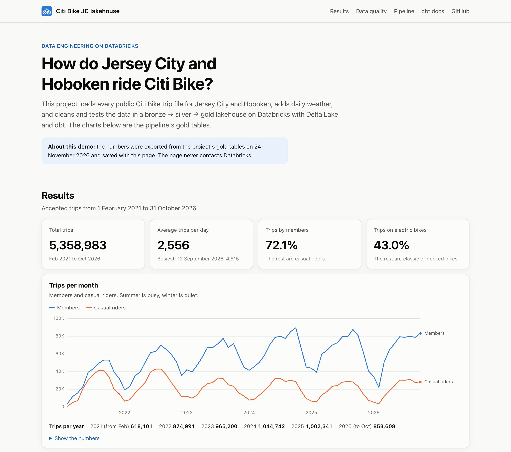
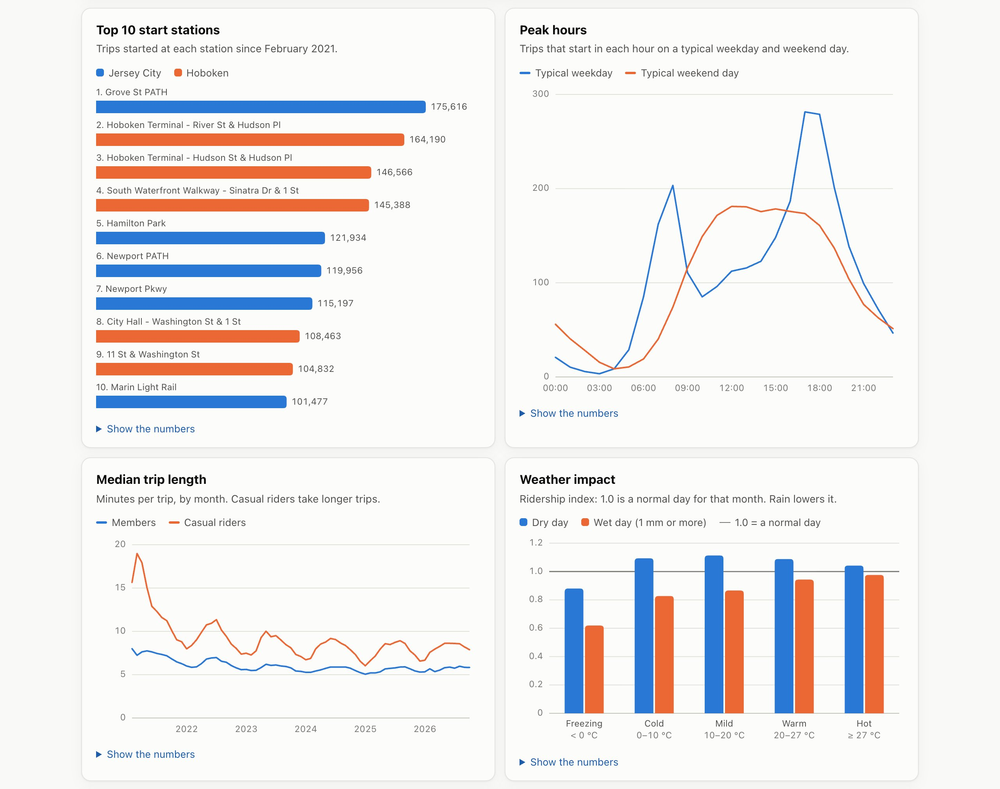
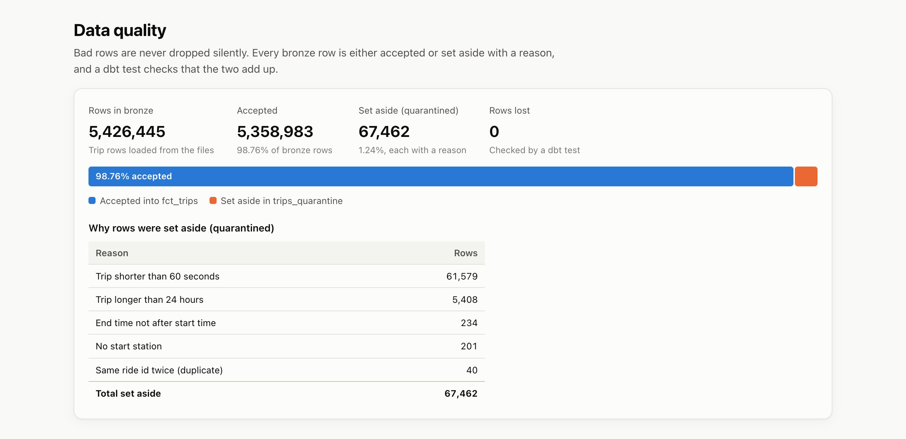
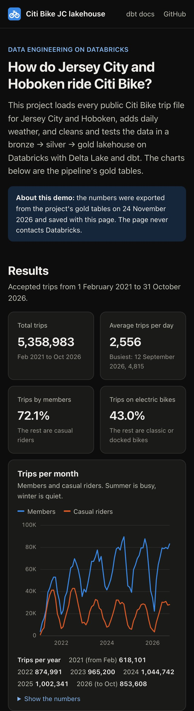
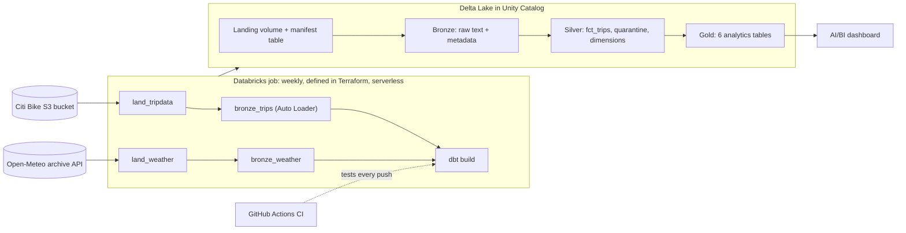
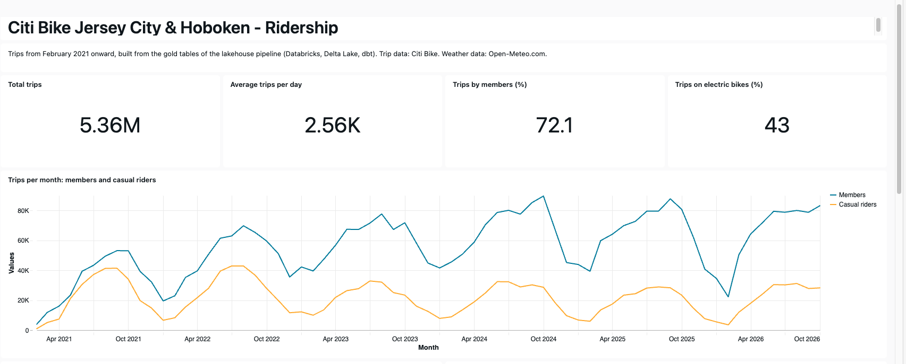
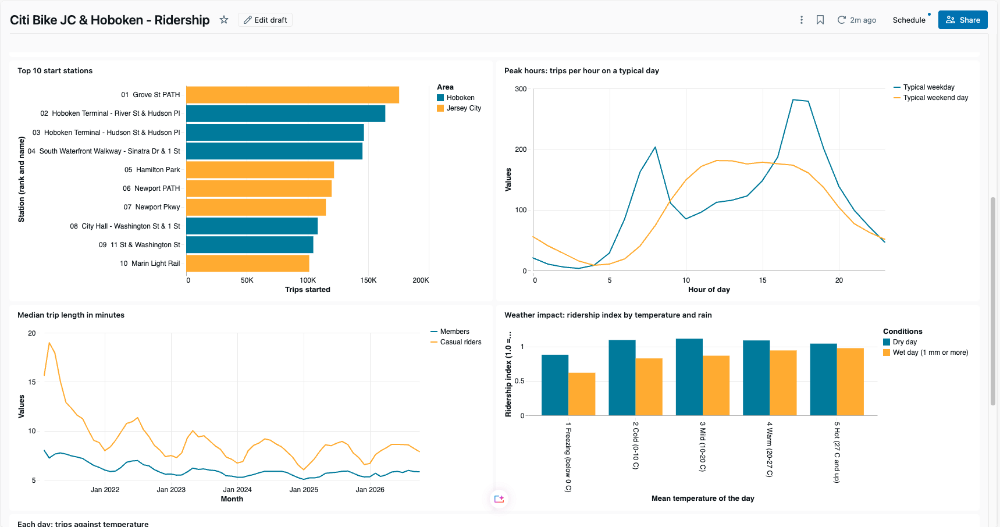
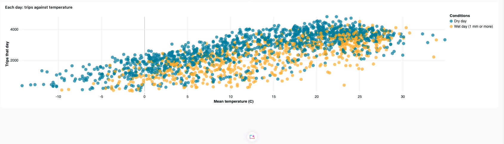
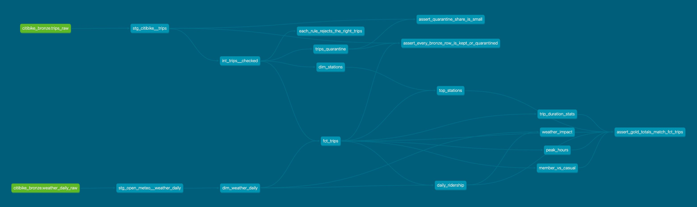
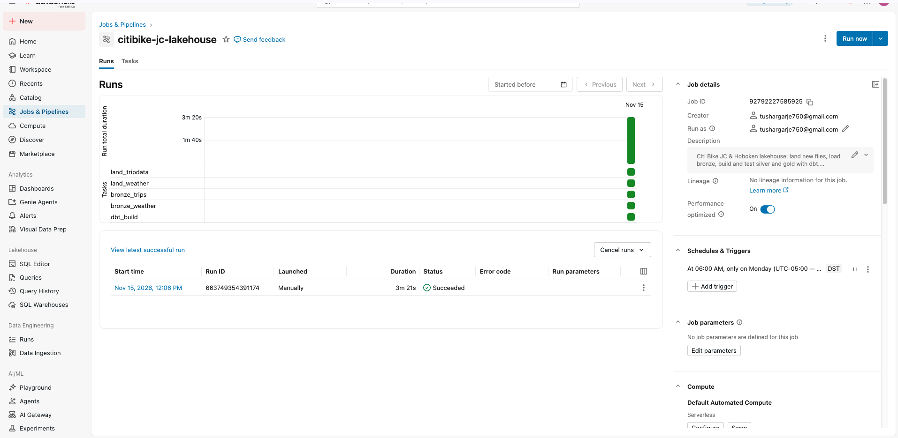

# Citi Bike Jersey City & Hoboken — Lakehouse Pipeline

[](https://github.com/tushargarje750-alt/citibike-jc-lakehouse/actions/workflows/ci.yml)
[](https://github.com/tushargarje750-alt/citibike-jc-lakehouse/actions/workflows/deploy-demo.yml)

**Live demo:** https://tushargarje750-alt.github.io/citibike-jc-lakehouse/
(the pipeline's results in your browser; nothing to install)<br>
**dbt docs and lineage graph:** https://tushargarje750-alt.github.io/citibike-jc-lakehouse/dbt-docs/



<details>
<summary>More screenshots</summary>

Top start stations, peak hours, trip length and weather impact, from the gold tables:



Data quality: every bronze row is either accepted or set aside with a reason:



The demo on a phone, in dark mode:



</details>

An end-to-end data engineering project on **Databricks Free Edition**. It takes the public
Citi Bike trip files for Jersey City and Hoboken, adds daily weather, and moves the data through
a bronze → silver → gold (medallion) architecture on **Delta Lake**. Transformations and tests are
written in **dbt**, the pipeline runs as a scheduled **Databricks job defined in Terraform**, and
**GitHub Actions** tests every push.

## How to use this project

There are four ways to use it. The first three need no Databricks account.

### 1. Look at the results (no install)

1. Open the [live demo](https://tushargarje750-alt.github.io/citibike-jc-lakehouse/).
2. Move the mouse over a chart (or tap it on a phone) to see the exact values.
3. Click **Show the numbers** under a chart to see its data as a table.

The demo is a static page. It shows results that were exported from the gold tables and saved with
the page, and it never connects to Databricks. The export date is written at the top of the page.
It uses the same seven SQL queries as the Databricks dashboard, so both show the same numbers.

### 2. Browse the models and tests (no install)

1. Open the [dbt docs](https://tushargarje750-alt.github.io/citibike-jc-lakehouse/dbt-docs/).
2. Pick a model on the left, for example `fct_trips`, to read what each column means and which tests check it.
3. Click the blue round button at the bottom right to open the lineage graph: raw files on the left, gold tables on the right.

### 3. Run the tests on your computer (no Databricks)

You need Python 3.12 and Git.

```bash
git clone https://github.com/tushargarje750-alt/citibike-jc-lakehouse.git
cd citibike-jc-lakehouse
python3.12 -m venv .venv && source .venv/bin/activate
pip install -r requirements-dev.txt
pytest
```

The tests cover the ingestion logic, the helper scripts, the dashboard definition and the demo data
file. To open the demo page from your own copy:

```bash
python3 -m http.server 8000 --directory site
```

Then open http://localhost:8000. (The dbt docs link only works on the published site.)

### 4. Run the whole pipeline in your own Databricks workspace

Do step 3 first. You also need a Databricks Free Edition workspace, the Databricks CLI and Terraform.

```bash
# 1. Settings: fill in host, HTTP path and a personal access token
cp .env.example .env
source scripts/activate.sh

# 2. Load the data: add this repo as a Git folder in Databricks, then run, in order,
#    ingestion/notebooks/01_land_tripdata, 02_land_weather, 03_bronze_trips, 04_bronze_weather

# 3. Build and test silver and gold
cd dbt && dbt build && cd ..

# 4. Create the scheduled job and the dashboard
databricks auth login --host https://<your-workspace> --profile citibike
cd infra/terraform && terraform init && terraform apply && cd ../..

# 5. Refresh the demo data (read-only SELECT queries on your SQL warehouse)
python scripts/export_demo_data.py
```

`.env` is ignored by Git, so your token is never committed. Step 5 rewrites `site/data/demo.json`;
committing it and pushing to `main` republishes the demo. The export stops with an error if the
numbers do not add up (for example, if bronze rows ≠ accepted + quarantined rows).

## Results at a glance

Every number below was copied from a real run. The full log, with the command that produced each
number, is in [docs/metrics_log.md](docs/metrics_log.md).

| | |
|---|---|
| Source files landed | 134 monthly files (2015-09 to 2026-10), 7,129,105 rows, 0 failed |
| Weather landed | 4,088 days from the Open-Meteo archive, 0 missing values |
| Bronze (current file format) | 5,426,445 rows from 69 files, loaded in 25.3 s |
| Bronze vs landing reconciliation | 0 of 69 months differ |
| Silver: accepted trips | 5,358,983 (98.76%) |
| Silver: quarantined rows | 67,462 (1.24%), each with a named reason; 0 rows unaccounted for |
| dbt project | 13 models, 73 data tests, 1 unit test, all passing |
| Scheduled job | 5 tasks, 201 s end to end |
| CI on each push | 69 Python unit tests, Terraform validation, full dbt build (87 steps in 71 s) |
| Dashboard | 4 KPI tiles and 6 charts, defined as code |
| Demo website | Static page on GitHub Pages, built from the dashboard's own 7 queries |

## Architecture



| Layer | Schema | What happens |
|---|---|---|
| Landing | `citibike_landing` | Each monthly zip is stored byte-for-byte in a Volume and its CSV extracted. A Delta **manifest table** records ETag, size, SHA-256, header and row count per file. A file is downloaded again only if its ETag changed. |
| Bronze | `citibike_bronze` | **Auto Loader** appends new CSVs to a Delta table. Every column stays text; six metadata columns record the source file and load time. Row counts per month are reconciled against the manifest and a mismatch fails the run. |
| Silver | `citibike_silver` | dbt types the data, applies nine named rejection rules, removes duplicate ride ids, and joins daily weather. `fct_trips` is an **incremental merge** on `ride_id`. Rejected rows go to `trips_quarantine` with the reason. |
| Gold | `citibike_gold` | Six aggregate tables: daily ridership, top stations, peak hours, member vs casual, weather impact, trip-duration stats. Each is tested to add up to `fct_trips`. |

## What the data shows

- **5.36 million trips** from February 2021 to October 2026, about 2,556 a day. 2024 was the peak year with 1,044,742 trips.
- **Members take 72.1% of trips.** Their median trip is 5.9 minutes; casual riders' is 9.3 minutes. Casual riders make 36.0% of their trips at weekends, members 23.1%.
- **Weekdays peak at 17:00, weekends at 12:00.**
- **Grove St PATH is the busiest start station** (175,616 trips), followed by the two Hoboken Terminal stations.
- **Rain costs about a fifth of ridership.** Compared with a normal day for the same month, wet days score 0.87 and dry days 1.07.

<details>
<summary>The same results in the Databricks AI/BI dashboard (screenshots from the workspace)</summary>





</details>

## Data quality

Bad records are never dropped silently. `int_trips__checked` gives every row a verdict, and a test
proves that bronze rows = accepted rows + quarantined rows.

| Rejection reason | Rows |
|---|---|
| Trip shorter than 60 seconds | 61,579 |
| Trip longer than 24 hours | 5,408 |
| End time not after start time | 234 |
| No start station | 201 |
| Duplicate `ride_id` | 40 |
| **Total quarantined** | **67,462 of 5,426,445 (1.24%)** |

Tests in the dbt project:

- **Generic tests:** `not_null`, `unique`, `accepted_values`, `relationships`.
- **Two custom generic tests:** `value_between` and `unique_combination` (in `dbt/tests/generic/`).
- **Three custom singular tests:** every bronze row is kept or quarantined; every gold table adds up to `fct_trips`; a warning if more than 5% of rows are rejected.
- **One dbt unit test:** twelve hand-written rows that check each rejection rule and the duplicate handling.

Discovery during landing also found two incompatible file formats (the switch is February 2021),
three header variants, and six file names that break the naming pattern, which is why files are found
by listing the bucket rather than by building URLs.

The dbt lineage graph, from the two bronze tables on the left to the six gold tables and the
tests that check them on the right:



## Orchestration and CI

**Databricks job.** One job with five tasks, defined in [infra/terraform](infra/terraform). Trips and
weather run in parallel and meet at `dbt build`. The job checks the code out from `main` on every run
and is scheduled for Mondays at 06:00 New York time.

| Task | Duration in the first run |
|---|---|
| `land_tripdata` | 43.3 s |
| `land_weather` | 33.5 s |
| `bronze_trips` | 34.6 s |
| `bronze_weather` | 16.6 s |
| `dbt_build` | 121.8 s |
| **Whole run** | **201.0 s** |



**GitHub Actions.** [ci.yml](.github/workflows/ci.yml) runs three jobs on every push and pull request:

1. Python unit tests for the ingestion logic, helper scripts and the dashboard definition.
2. `terraform fmt -check` and `terraform validate`.
3. A real `dbt build --full-refresh` against Databricks, on one month of data, into separate `ci_` schemas.

[deploy-demo.yml](.github/workflows/deploy-demo.yml) publishes the website to GitHub Pages: the
demo page at the root, and the dbt docs, rebuilt from the real schemas, under `/dbt-docs/`. If
Databricks cannot be reached, the build fails and the site published before stays online.

## Tech stack

Databricks (Free Edition, serverless, Unity Catalog) · Delta Lake · Auto Loader · dbt Core 1.12 with
dbt-databricks 1.13 · Terraform (Databricks provider) · GitHub Actions · Python 3.12 · pytest ·
Databricks AI/BI dashboards

## Repository layout

```
ingestion/citibike_ingest/   plain-Python ingestion logic (listing, incremental selection, weather)
ingestion/notebooks/         thin Databricks notebooks: 01-02 landing, 03-04 bronze
dbt/                         dbt project: staging, intermediate, marts/core (silver), marts/analytics (gold)
infra/terraform/             the job and the dashboard as code
dashboards/                  dashboard definition (.lvdash.json)
scripts/                     run summaries, docs site helper, demo data export
site/                        the demo website (HTML, CSS, JavaScript; no build step) and its data file
tests/                       Python unit tests
.github/workflows/           CI and website publishing
docs/                        plan, decisions, metrics log, screenshots
```

## Design decisions and limits

The reasoning behind each choice is in [docs/decisions.md](docs/decisions.md). The main limits:

- **Only the current file format is modelled.** The 65 older-format months (2015-09 to 2021-01, 1,702,660 rows) are landed and inventoried but not loaded into bronze.
- **Free Edition constraints.** Serverless compute only, one small SQL warehouse, a daily usage quota, personal-access-token authentication, and local Terraform state.
- **Republished months.** A republished file is detected and reloaded, and its rides replace the earlier rows. Rides that were removed from a republished file stay until a full refresh.
- **Weather is one grid point** of a reanalysis dataset, not a station measurement.

## Data sources

- Trip data: [Citi Bike system data](https://citibikenyc.com/system-data), used under the NYC Bike Share data licence agreement.
- Weather data by [Open-Meteo.com](https://open-meteo.com/), CC BY 4.0.
